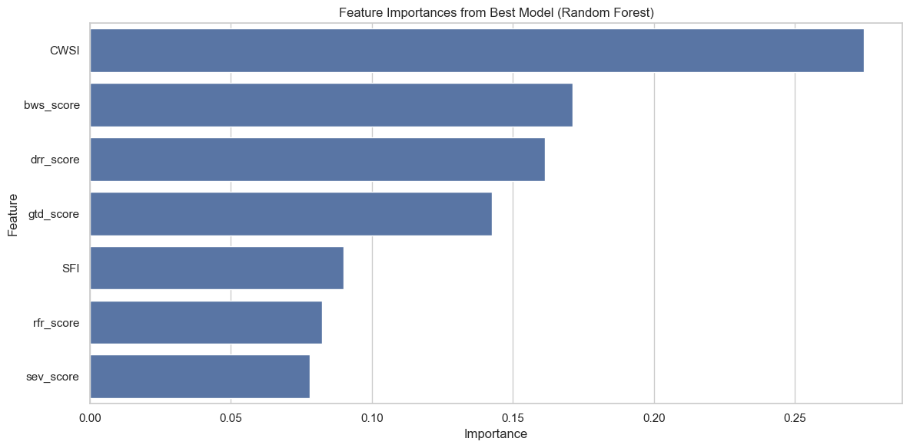

# Water Resource Risk Classification with Supervised Learning

A supervised machine-learning project that predicts a country's **Water Resource Risk Category (0–4)** from hydrological indicators. It covers feature engineering, a five-model comparison, hyperparameter tuning and feature-importance analysis.

Built as **HW1** for the **CENG 463 – Introduction to Machine Learning** course. The full assignment description is in [`CENG463_HW1.pdf`](CENG463_HW1.pdf).

## Dataset

`water_risk_dataset.csv` (4,555 rows) is derived from the **World Resources Institute (WRI) Aqueduct Water Risk Atlas**.

| Column | Description |
| --- | --- |
| `gid_0` | Country code (dropped before training to avoid memorization) |
| `bws_score` | Baseline water stress |
| `gtd_score` | Groundwater depletion |
| `drr_score` | Drought risk |
| `rfr_score` | River flood risk |
| `sev_score` | Seasonal variability |
| `w_awr_def_tot_cat` | **Target:** water risk category (0–4) |

## Approach

1. **Feature engineering**: two derived features are added:
   - **Composite Water Stress Index:** `CWSI = 0.5·bws + 0.3·gtd + 0.2·drr`
   - **Seasonal–Flood Interaction:** `SFI = sev · rfr`
2. **Baseline models**: Random Forest, SVM, KNN, Gaussian Naive Bayes and Logistic Regression. The data uses a stratified 80/20 train/test split. Scale-sensitive models (SVM, KNN, Logistic Regression) are wrapped in a `StandardScaler` pipeline.
3. **Hyperparameter optimization**: `GridSearchCV` with 5-fold cross-validation and accuracy scoring, plus a classification report for every tuned model.
4. **Feature importance**: computed with the tuned Random Forest.

## Results

| Model | Baseline accuracy | Tuned accuracy | Δ |
| --- | --- | --- | --- |
| **Random Forest** | **0.9122** | **0.9122** | 0.0000 |
| KNN | 0.8035 | 0.8858 | +0.0823 |
| SVM | 0.7651 | 0.8167 | +0.0516 |
| Logistic Regression | 0.6729 | 0.6707 | −0.0022 |
| Gaussian Naive Bayes | 0.6048 | 0.6224 | +0.0176 |

Best tuned parameters:

- **Random Forest:** `n_estimators=200`, `max_depth=20`
- **KNN:** `k=3`, `weights=distance`, `metric=manhattan`
- **SVM:** `C=100`, `kernel=rbf`

**Random Forest is the best model** (≈91% test accuracy). The engineered **CWSI** feature is the strongest predictor:

| Rank | Feature | Importance |
| --- | --- | --- |
| 1 | CWSI | 0.274 |
| 2 | bws_score | 0.171 |
| 3 | drr_score | 0.161 |
| 4 | gtd_score | 0.143 |
| 5 | SFI | 0.090 |



## Getting Started

```bash
python -m venv venv
source venv/bin/activate        # Windows: venv\Scripts\activate
pip install -r requirements.txt jupyter
jupyter notebook CENG463_HW1_GroupID.ipynb
```

Run the notebook from the repository root so `water_risk_dataset.csv` is found.

## Project Structure

```
.
├── CENG463_HW1_GroupID.ipynb   # Full analysis notebook
├── water_risk_dataset.csv      # Dataset (WRI Aqueduct)
├── CENG463_HW1.pdf             # Assignment specification
├── requirements.txt
└── assets/                     # Figures used in this README
```

## Tech Stack

Python · pandas · NumPy · scikit-learn · Matplotlib · Seaborn · Jupyter
